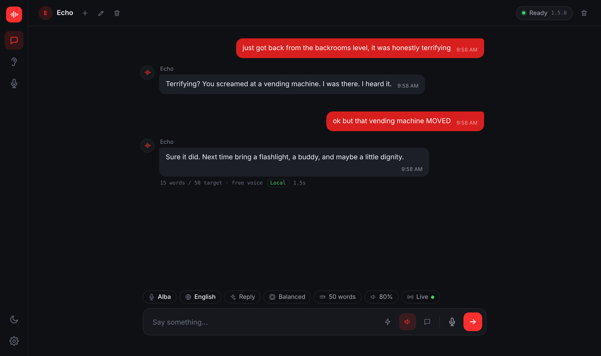
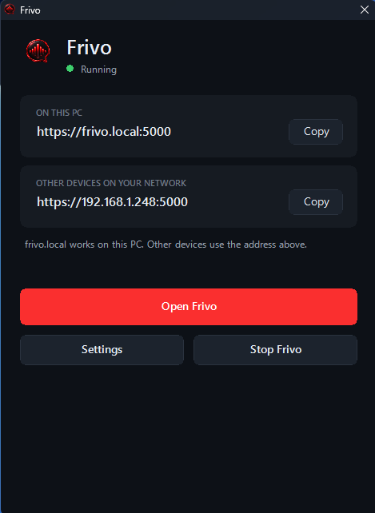
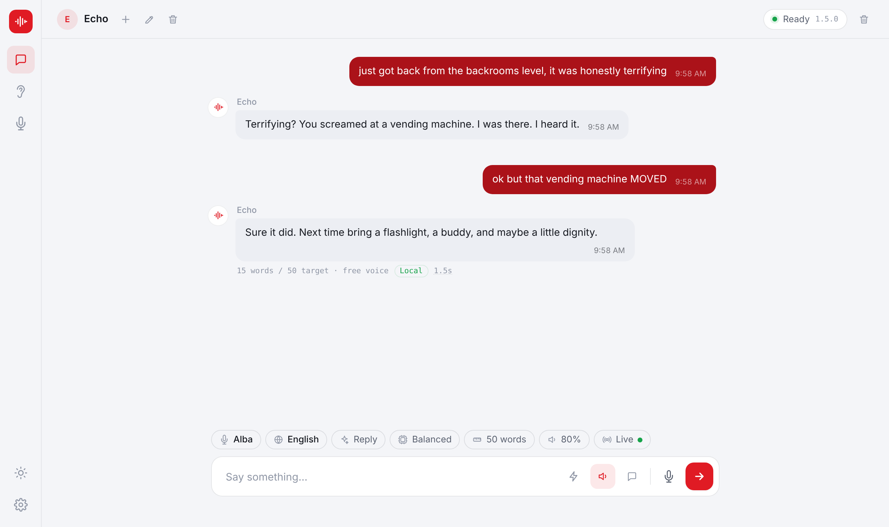
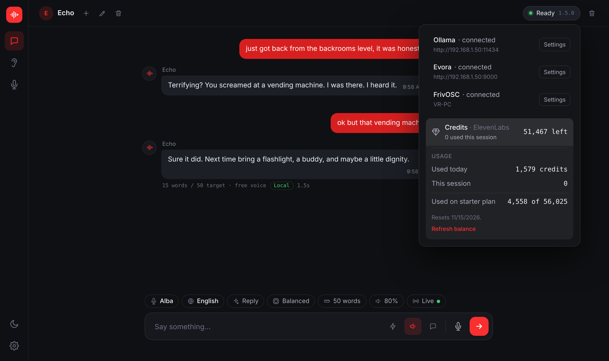
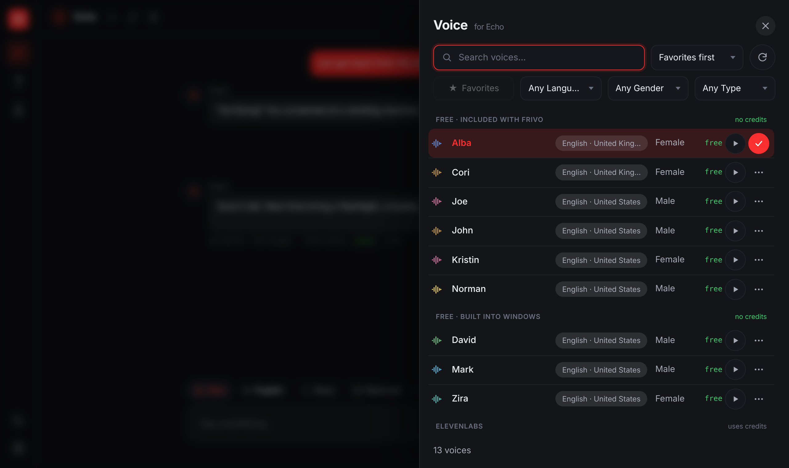
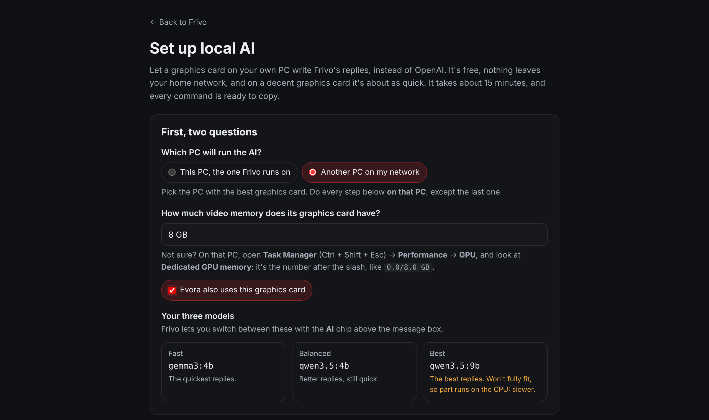
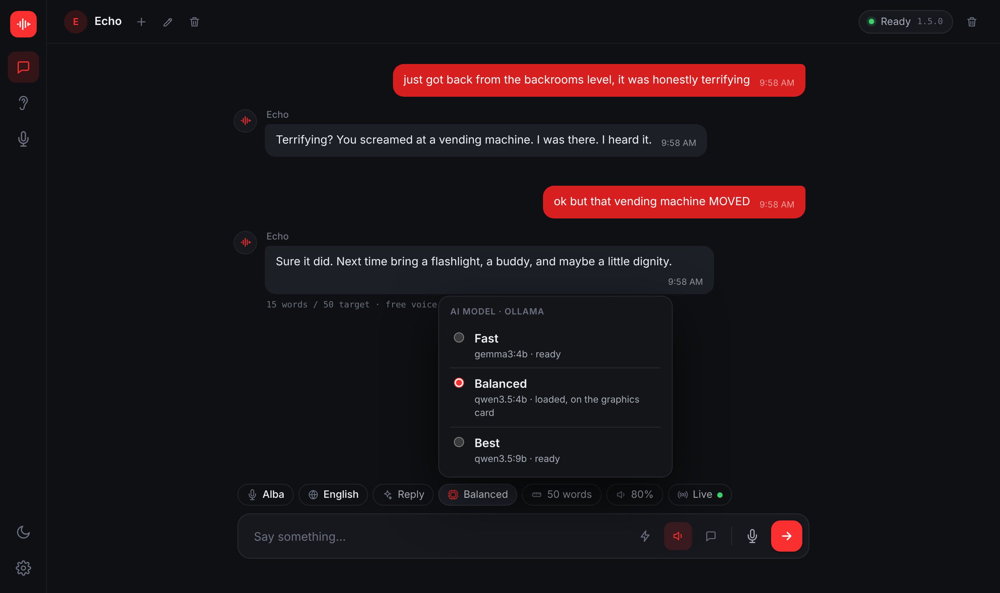
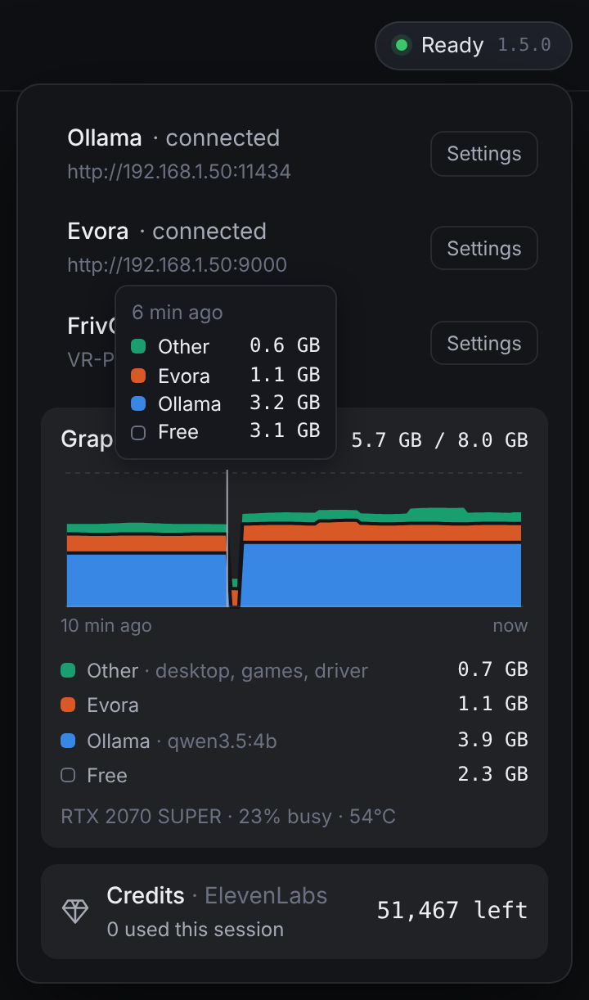
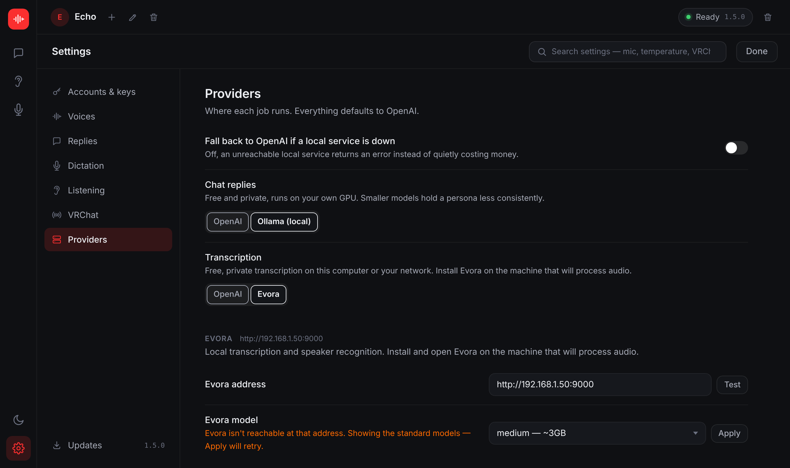
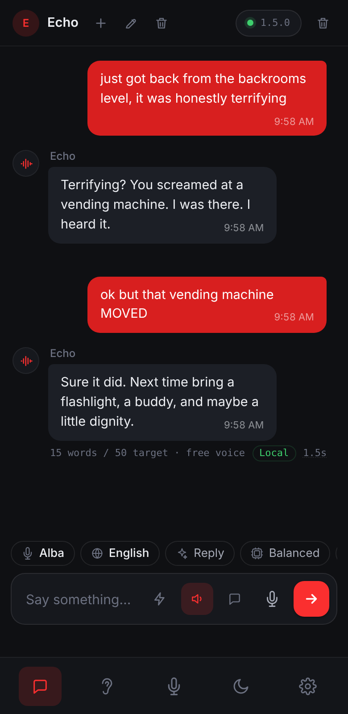

# Frivo

**Frivo gives you a voice.** Type (or say) something, and Frivo speaks it out
loud for you — cleaned up, translated, or answered in character by a
personality you make.

Send that voice into VRChat with the words in your chatbox, have Frivo
listen to the people around you and translate what they say, or run the AI
on your own graphics card so it costs nothing.

Frivo runs on your Windows PC and opens in your web browser. Your phone or
another computer on your home network can use it too.

## What it can do

- **Speak for you, three ways.** *Clean up* says what you meant, with typos
  and grammar fixed. *Word for word* says exactly what you typed. *Reply*
  has a character answer it in its own personality.
- **Characters.** Make as many characters (profiles) as you like, each with
  its own personality, voice and language.
- **Speak every reply.** Pick from 6 free voices that come with Frivo, the
  voices built into Windows, or realistic ElevenLabs voices.
- **Talk instead of typing.** Click the microphone and say your message.
- **Speak any language.** Write in English and have it spoken in Japanese,
  Spanish, or another language.
- **Listen and translate.** Frivo can listen to a game, a call or the room,
  tell different people apart, and translate what they say.
- **Work with VRChat.** Spoken replies can go into your VRChat voice, and the
  words show up in your chatbox, page by page, as the voice reads them.
- **Run the AI yourself, for free.** Use OpenAI, or let a graphics card on
  your own network write the replies with Ollama.

## Install

1. Download `FrivoSetup.exe` from the
   [latest release](https://github.com/Friday7352/Frivo/releases/latest).
2. Double-click it and allow the Windows permission prompt.
3. Click through setup. The default choices are fine.
4. Leave **Launch Frivo now** ticked and click **Finish**.

Setup needs the internet. It downloads Python, the libraries Frivo uses, and
the six free voices (about 280 MB, once — updates keep them). Frivo works on
Windows 10 and Windows 11.

The small Frivo window keeps Frivo running. Click **Open Frivo** to open it
in your browser, or go to `https://frivo.local:5000`.

## First run: pick a brain and a voice

Frivo needs something to **write** replies and something to **speak** them.
Open **Settings** (the gear at the bottom left) and choose:

| To write replies | What you need |
| --- | --- |
| OpenAI (default) | An [OpenAI API key](https://platform.openai.com/api-keys), in **Accounts & keys**. Pay per use. |
| Local AI (free) | A PC with a graphics card running Ollama. See [Local AI](#local-ai-free-replies-on-your-own-graphics-card). |

| To speak replies | What you need |
| --- | --- |
| Free voices | Nothing. They work straight away. |
| ElevenLabs | An [ElevenLabs API key](https://elevenlabs.io/app/settings/api-keys), in **Accounts & keys**. Uses your ElevenLabs credits. |
| No voice | Turn off the speaker button next to the message box. Text only, costs nothing. |

You pay OpenAI and ElevenLabs directly for anything you use with them.

## Using Frivo

**Top bar.** The character you are talking to. Use **+** to make a new one,
the pencil to change its personality, and the bin to delete it. **Ready**
on the right shows that everything is working; click it for details.

**The row of chips above the message box** changes how replies come out.
Click any of them:

| Chip | What it does |
| --- | --- |
| **Voice** (e.g. *Alba*) | Who speaks the reply. |
| **Language** (e.g. *English*) | What language it's spoken in. |
| **Reply** | What Frivo does with your message: **Clean up** (says what you meant, fixed up), **Word for word** (exactly what you typed), or **Reply** (a character answers it). |
| **Fast / Balanced / Best** | Which local AI model writes replies. Only shown when you use local AI. |
| **50 words** | How long replies should be. |
| **80%** | Voice volume. |
| **Live** | VRChat is connected through FrivOSC. Only shown when VRChat is turned on. |

**Buttons in the message box**, from left to right:

- ⚡ **Auto-send** — sends your message as soon as you stop talking.
- 🔊 **Speak** — reads replies aloud. Turn it off for text only.
- 💬 **Chatbox** — shows replies in your VRChat chatbox.
- 🎤 **Dictation** — click and talk instead of typing. It's always off when
  Frivo opens.

**Hover over a reply** to see which voice spoke it and whether it was written
**Local**ly or by **OpenAI**.

**Left side:** chat, **Listening** (hear and translate other people),
**Voices**, light/dark theme, and **Settings**.

### Status and usage

Click **Ready** to see what is connected and how many ElevenLabs credits
you have left.

## Voices

There are three kinds of voices:

- **Free · included with Frivo** — Kristin, Cori, Alba, John, Joe and Norman.
  Natural-sounding, run on your PC's processor (no graphics card), and use
  very little of it.
- **Free · built into Windows** — David, Mark, Zira and any other voices
  installed in Windows. Instant, but more robotic.
- **ElevenLabs** — the most realistic, with thousands to choose from. Each
  reply uses ElevenLabs credits.

Click ▶ to hear a voice before you pick it. Each character remembers its own
voice.

## Local AI: free replies on your own graphics card

Frivo can use [Ollama](https://ollama.com) to write replies on a graphics card
instead of OpenAI. It can be this PC or another PC on your home network. It
costs nothing per message and nothing leaves your home.

Frivo has a step-by-step guide built in. Open **Settings** > **Providers**,
choose **Ollama (local)**, then click **New to this? Set it up step by
step**. Tell it how much video memory your graphics card has and it picks
the right models and gives you every command to copy and paste.

Frivo uses three models, and you can switch between them any time with the
AI chip:

- **Fast** — the quickest replies.
- **Balanced** — better writing, still quick.
- **Best** — the best writing, a bit slower.

Small local models are not as clever as ChatGPT. If grammar and punctuation
matter, use **Balanced** or **Best**, or OpenAI.

### Keep an eye on the graphics card

Click **Ready** to see how full the graphics card's memory is over the last
10 minutes, and how much of it Ollama, Evora and everything else are using.
Hover over the graph to see any moment. This needs the latest Evora running on
the PC with the graphics card. Without it, Frivo shows only Ollama's
models.

## Settings

Settings are grouped down the left side. Use the search box at the top to
find any setting by name.

**Providers** chooses where each job runs: OpenAI or Ollama for replies, and
OpenAI or Evora for turning speech into text. **Fall back to OpenAI** makes
Frivo use OpenAI if your local service is down, instead of showing an error.

## Optional companion apps

### Evora — private speech-to-text

[Evora](https://github.com/Friday7352/Evora) turns speech into text on your
own PC instead of sending it to OpenAI, and recognises different speakers.
It can share a graphics card with Ollama.

1. Install `EvoraSetup.exe` from the
   [latest Evora release](https://github.com/Friday7352/Evora/releases/latest).
2. In Frivo, open **Settings** > **Providers** > **Transcription**, choose
   **Evora** and enter the address the Evora window shows.
   On the same PC, that's `http://evora.local:9000`.

### FrivOSC — VRChat

FrivOSC connects Frivo to VRChat. Replies show up in your chatbox, and
muting or unmuting in VRChat can turn Frivo's dictation off and on.

**It's built into the Frivo app** (2.0.0 and later). Run the app on the PC
you play VRChat on (*Run Frivo here, in the Frivo app*, or *Just the Frivo
app* if Frivo runs on another PC), and it connects VRChat to Frivo by itself
whenever VRChat is running. Nothing else to install.

1. In VRChat, turn on OSC in the Options menu.
2. In Frivo, open **Settings** > **VRChat** and turn on **VRChat OSC**.

It can be turned off in **Settings** > **App** > **VRChat on this PC**. Using
Frivo in a browser instead of the app? The separate
[FrivOSC](https://github.com/Friday7352/FrivOSC/releases/latest) still works:
install it on the VRChat PC. Setup offers to remove it once the app is
installed, since the app does its job.

Then turn on the 💬 **Chatbox** button. Long replies are split into pages of
144 characters (VRChat's limit), and each page changes exactly when the voice
reaches it. Anyone who can see your chatbox can read these messages.

More about VRChat

- VRChat only talks OSC to its own PC, which is why FrivOSC has to run there.
  FrivOSC only makes outgoing connections, so you don't need to open ports or
  change VRChat's launch options.
- **Follow VRChat mute**: unmuting in VRChat starts dictation, muting stops it.
  The microphone button still works at any time.
- **Unmute when I send**: unmutes you before a spoken reply plays, so it isn't
  lost into a muted mic. It never mutes you.
- The mute options need **Options > Voice > Toggle Voice** on in VRChat (the
  default). With push-to-talk, the log says so (`%APPDATA%\Frivo App\frivosc.log`
  for the app, FrivOSC's own log for the separate one).

### Voicemeeter — audio routing

Not required, but recommended for VRChat or the Listening feature. Use a
virtual cable to send Frivo's voice into VRChat's microphone, and another so
Frivo hears only the game or app you choose, not your own mic. Frivo doesn't
install or set up Voicemeeter.

## The Frivo app (Windows)

The Frivo app is Frivo in its own window, with a tray icon and no browser tab.
Setup asks what each PC is for:

- **Run Frivo here, in the Frivo app** (the default). Frivo runs in the
  background and the app is its window, so there's only one thing to open.
  The Frivo shortcuts and starting with Windows open the app.
- **Run Frivo here, without the app.** Frivo and its launcher, used in a
  browser. For a PC that phones and other PCs connect to.
- **Just the Frivo app.** For a PC that connects to Frivo on another PC. Pick
  it from the list of Frivo found on your network (or type its address) and
  type the pairing code shown in its launcher, or in Frivo under Settings ›
  Other devices. The app remembers it after that.

For phones, Settings › Other devices has a QR code to scan and the steps to
trust Frivo's certificate. Setup can also start Frivo **before anyone signs
in**, for a PC that only runs Frivo for others.

The app comes inside `FrivoSetup.exe`: it's the only download, whichever of
the three you pick.

The app shows Frivo's own pages, so every Frivo update shows up in it. When
setup updates Frivo it updates the app on that PC too, and an app on another
PC picks up its update from the Frivo it's connected to. Its
settings (where Frivo runs, starting with Windows, what closing the window
does) are under **Settings › App** and on the tray icon's menu. Phones and
browsers keep working as before.

## Use Frivo on your phone or another PC

During setup you can allow other devices on your home network. The Frivo
window then shows an address like `https://192.168.x.x:5000`. Open it on your
phone or another computer.

The first visit may show a certificate warning, because Frivo's certificate
is only trusted on the PC it's installed on. Only allow this on a network you
trust. If you skipped it during setup, turn it on in the Frivo window's
**Settings**.

**The Server page.** On a PC set up as Frivo without the app, the Frivo
shortcut opens the Server page in your browser, and Frivo's launcher stays in
the tray (**Show launcher** on its menu brings its window up). The page has the address and QR code for connecting a device, the
pairing code, whether everything's working, who's using Frivo right now and
what they're doing, the graphics card, and what Frivo logged lately, with
Restart and Stop. **Open chat** takes you to the chat. It's also at
**Settings › Other devices › Server page**.

## Your data

Everything stays on your PC, in `%APPDATA%\Frivo\`: settings, characters,
API keys, usage history and recent audio.

- API keys are saved in `config.json` as plain text. Don't share that file.
- Spoken audio is deleted after 7 days. Change `audio_keep_days` in
  `config.json` to keep it longer or shorter.

## Updates

Frivo checks for updates every six hours. When there's a new version, an
**Update available** chip appears at the bottom of the sidebar. Click it to
see what's new, then **Update now**. Frivo installs it, restarts, and keeps
your settings, characters and keys. You can also choose **Later** or **Skip
this version**.

**Settings** > **About Frivo** has **Check for updates** and **Earlier
versions**, which lets you go back to any release from 1.4.0 onward.

How updates work

Frivo downloads `FrivoSetup.exe` from this repository's GitHub releases,
checks it against the SHA-256 fingerprint GitHub publishes, and installs it on
the Frivo PC through a Task Scheduler task called **Frivo Updater**, so no
permission prompt appears. If that task is missing, Windows asks for
permission instead, and running `FrivoSetup.exe` once sets the task up again.

## Uninstall

Open Windows **Settings** > **Apps** > **Installed apps**, find **Frivo** and
click **Uninstall**. It asks whether to also delete your saved keys and
settings; leave that unticked if you plan to reinstall.

Running `FrivoSetup.exe` on a PC that already has Frivo offers **Update**,
**Repair** (rebuilds Frivo, keeps your settings) and **Uninstall**.

## Troubleshooting

| Problem | Where to look |
| --- | --- |
| Setup failed | `%TEMP%\Frivo-Setup.log` |
| An update failed | The update dialog says why. Details are in `%ProgramData%\Frivo\Updates\updater.log` |
| Something else | The Frivo window has buttons to open the server log and the settings folder. |
| Local AI isn't working | The troubleshooting section at the bottom of the setup guide. |
| A free voice is missing | Run `FrivoSetup.exe` and choose **Repair**. |

## Voice credits

Frivo's free voices are [Piper](https://github.com/OHF-Voice/piper1-gpl)
voices, as published by [sherpa-onnx](https://github.com/k2-fsa/sherpa-onnx),
which also speaks them. Kristin, Cori, John and Norman are trained on
public-domain LibriVox recordings, and Joe on CC0 recordings. Alba is trained
on recordings from the University of Edinburgh
([CC BY 4.0](https://datashare.ed.ac.uk/handle/10283/3270)). The pronunciation
data is from [eSpeak NG](https://github.com/espeak-ng/espeak-ng) (GPL-3.0).
`voices\piper\CREDITS.txt` in the install folder lists them too.

## For developers

Building, versions and tests

**Building.** Clone the repository and run `Install.bat` to install from
source. To build, run **`Build.bat`**. It writes `dist\FrivoSetup.exe`, the
one installer (Frivo, the Frivo app, or both), with the app inside it. Nothing needs
installing first: it fetches Inno Setup and a private copy of Node.js when
it needs them. The app is only rebuilt when something in `desktop\`
changed; `Build.bat /app` forces it.

**Version number.** The version lives only in `VERSION` at the root of the
repository. Everything else — the installer, Apps & features,
`FrivoHost.exe` and `/diagnose` — reads it at build time. The app's version
in `desktop\package.json` is kept the same.
`tests/test-version.py` checks they agree.

**Publishing an update.**

1. Change `VERSION`, and the `version` in `desktop\package.json` to match.
   Run `Build.bat`.
2. Create a GitHub release tagged with that version, such as `v2.0.0`. It
   can't be a pre-release or a draft. Attach `dist\FrivoSetup.exe`, keeping
   that exact name. That's the only file.

Installed copies offer it within six hours. The release notes appear in the
update dialog.

**The Frivo app.** Its code is in `desktop\`; `Build.bat` builds it too. See [`desktop/README.md`](desktop/README.md) for how it works.

**Tests.** See [`tests/README.md`](tests/README.md).

**Screenshots.** The pictures in this README are of Frivo running with demo
data, in `docs/screenshots/`.

